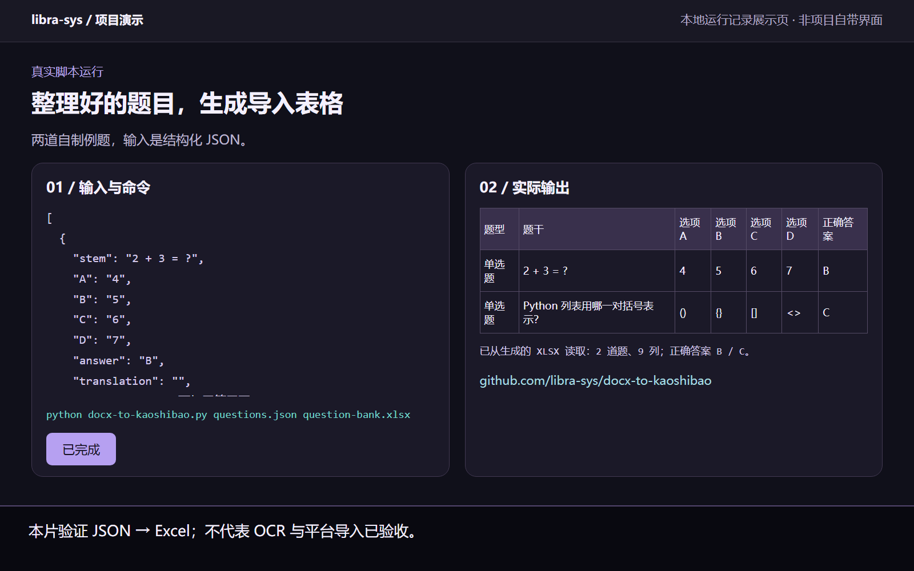

# 题库转换助手（DOCX 转考试宝）

## 图文演示



本例将两道自制题目的 JSON 输入交给 `scripts/build_kaoshibao_bank.py`，实际生成 XLSX，再从文件读取题干和答案列显示。截图中的展示页不是考试宝或本项目自带界面；示例副本使用了简化脚本名。

此例只验证 **JSON → Excel**。Word/OCR 识别、人工校对与考试宝实际导入仍是独立步骤，不据此宣称全流程自动化已经验收。


> WorkBuddy Skill · 作者 libra-eyes · MIT 协议

## 这是什么

从 Word 文档（含扫描/OCR）中提取选择题，生成可一键导入考试宝的 Excel 题库，含题干校对、答案解析与中文翻译。

> Extract multiple-choice questions from Word documents (including scanned/OCR) into an Excel question bank importable by Kaoshibao.

- **服务类目**：教育服务
- **标识**：`docx-to-kaoshibao`

## 触发词

- 见 SKILL.md 内触发说明

## 安装

把 `docx-to-kaoshibao/` 整个目录复制到 WorkBuddy 用户级技能目录：

- Windows：`C:\Users\<你的用户名>\.workbuddy\skills\`
- macOS / Linux：`~/.workbuddy/skills/`

然后在 WorkBuddy 中重新加载技能即可使用。

也可以打包上传到 [WorkBuddy 开放平台](https://open.workbuddy.cn) 的技能市场。

## 脚本的实际输入与能力边界

本仓库包含 Skill 工作流和一个 Excel 生成脚本。命令行脚本直接接收 **JSON 题目列表**，不会自动完成 Word/OCR 到已校对题目的全过程；Word/OCR 提取、选项识别和答案校对应由前置工作流完成。

安装脚本依赖：

```bash
python -m pip install openpyxl
```

准备 `questions.json`：

```json
[
  {
    "stem": "1 + 1 = ?",
    "A": "1",
    "B": "2",
    "C": "3",
    "D": "4",
    "answer": "B",
    "translation": "",
    "explanation": "一加一等于二。"
  }
]
```

运行：

```bash
python scripts/build_kaoshibao_bank.py questions.json questions.xlsx
```

当前脚本输出单选题表格。2026-11-02 已用自制样例检查题型表头、题干和答案列；这不等于 OCR 正确性、考试宝现行模板兼容性或实际平台导入已经验收。导入前请核对平台模板并试导少量题目。

## 目录结构

```
docx-to-kaoshibao/
├── SKILL.md
├── scripts/build_kaoshibao_bank.py
```

## 许可

MIT License · Copyright (c) 2026 libra-eyes
